# StopMove user guide

_Version 3.0  |  Ashita v4 addon  |  user guide_

> **Download:** https://github.com/Benthere407/StopMove/releases/latest  
> **Project page:** https://github.com/Benthere407/StopMove  
> Tested on a current LandSandBoat (LSB) server running locally.

## Overview

### What it does

StopMove blocks your numpad movement keys (and, if you want, W/A/S/D) while you are casting, so you can't walk and interrupt a spell by accident. It can also turn Multisend follow and the game's own auto-follow (`/follow`) off for the length of the cast and back on afterwards. A small on-screen widget shows ON / OFF / LOCK for each of your characters, across two clients, in one of three themes.

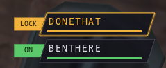 <em>The Vex theme (Party, view A): Donethat is locked mid-cast, Benthere is ON.</em>

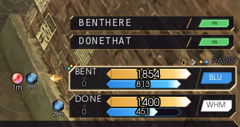 <em>The Hex link theme (view A), next to the YunaUI Hex party list it is modelled on.</em>

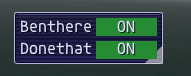 <em>The Classic theme, as in 2.0.</em>

### What's new in 3.0

- **Three widget themes.** Classic (the 2.0 look), **Vex** and **Hex link**, modelled on the YunaUI party lists. Each theme keeps its own settings, and each has its own Reset.
- **A new settings window** in the VanaCore menu style, with a sidebar, Search and separate pages.
- **Save and load** whole setups by name, and **push** a setup or a theme to the other client.
- **Looks are per character.** Each character keeps its own theme; only casting, follow and timing settings are shared.
- **INT on the widget**: a red INT blinks for 2 seconds when a cast is interrupted.
- **Long casts are covered automatically.** The safety timer never ends before the spell's own cast time plus 2 seconds, so Stoneskin, Raise and Teleports stay locked. Max cast lock now defaults to 9 seconds.
- **Paralyzed and intimidated casts count as interrupted**, so follow waits instead of pulling you away.
- **Shift + drag** moves the widget at any time.
- **Removed:** the UI and Allow Move buttons on the widget. Use a right-click or `/stopmove` for settings, and `/stopmove move` to end a lock.

### Built with AI

StopMove was made with Claude (Anthropic's AI assistant). Benthere407 described what was wanted and tested each version in game; Claude wrote the code. The full source is in the zip as plain Lua, so anyone can read it.

### What it works with

| Item | Details |
|---|---|
| Client | Ashita v4 (Lua addon). Not for Windower. |
| Tested on | A current LandSandBoat (LSB) server running locally. |
| Renderer | The widget uses Ashita's built-in ImGui, so it should work with whatever renderer Ashita supports. |
| Optional | Multisend (by ThornyFFXI) for the Multisend follow option, used only through its `/ms follow` command. The in-game `/follow` option needs nothing extra. |
| Also used with | The author runs it next to LegacyAC and YunaUI. No conflicts known. The Vex and Hex link themes do not need YunaUI installed. |

## Install and uninstall

### How to install

1. Unzip `stopmove.zip`. You get a folder called `stopmove` containing `stopmove.lua`.
2. Copy the whole `stopmove` folder into your Ashita addons folder, so that this file exists: `<Ashita folder>\addons\stopmove\stopmove.lua`
3. In game, type `/addon load stopmove`. The widget appears at the left of the screen.
4. To load it automatically, add the line `/addon load stopmove` to your Ashita startup script (usually `<Ashita folder>\scripts\default.txt`, or whichever script your profile runs).
5. Running two clients? Do this once; both clients share the same Ashita folder. Load it on each client.

### Updating from an older version

Replace `stopmove.lua` with the new one and type `/addon reload stopmove` on each client. Your settings are kept, and the widget starts in the Classic theme with your old look. From 3.0 on, each character keeps its own look, so changing the look on one client no longer changes the other.

Max cast lock keeps the value you had (6 seconds unless you changed it). The new default is 9; click the reset icon of the Lock section on the Timing page to use it.

### How to uninstall

1. In game: `/addon unload stopmove`.
2. Delete the line `/addon load stopmove` from your startup script, if you added it.
3. Delete the folder `<Ashita folder>\addons\stopmove`. This also deletes your saved setups (its `saved` folder), so copy that first if you want to keep them.
4. Optional: delete the settings folder `<Ashita folder>\config\addons\stopmove` (saved looks, positions and ON/OFF state).

## How to use StopMove

### The widget

Each character gets an ON / OFF tag. Green means ON, red means OFF, gold or orange **LOCK** shows while a cast is protecting you, and a blinking red **INT** shows for 2 seconds after a cast is interrupted.

- Click a character to switch it on or off. With two clients running, either widget can switch either character.
- **Shift + drag** moves the widget. While the settings window is open, any drag moves it, even at the smallest size.
- Roll the mouse wheel over the widget to make it bigger or smaller, or set Widget size on the Appearance page.
- Right-click the widget, or type `/stopmove`, to open the settings window.
- If the widget ends up off-screen or huge, type `/stopmove resetbox`.
- Its position, size, look and ON/OFF state are remembered per character.

### Themes

Pick a theme on the **Widget > Appearance** page. Everything below the Theme row belongs to that theme, so you can set up all three and switch between them freely. **Reset <theme>** puts only that theme back to its defaults, and **Copy <theme> to <other character>** sends it to the other client.

| Theme | What it looks like |
|---|---|
| Classic | The 2.0 widget: names next to square or circle badges, on a solid or FFXI-menu background, with Low profile and Letter inside the shape for the smallest sizes. |
| Vex | After the YunaUI Vex party list: capital names on dark slanted plates with coloured bars, and an ON / OFF tag. Two row styles (Party and Menu), two views and three letter styles. |
| Hex link | After the YunaUI Hex party list: capital names on a dark plate with gold corner accents, a gold divider and a job-box style ON / OFF tag. Two views and three letter styles. |

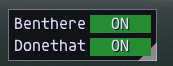 <em>Classic with a solid background.</em>

#### Vex

- **Row style: Party.** Rows on their own, with no box or border behind them. **View A**: the ON / OFF tag, then the name plate over a bar in the state colour. **View B**: the name plate (the name over two slanted bars, with an empty spot at the right), then the tag.
- **Row style: Menu.** Rounded cards. Each card's edge fades from pink-red on the left to violet on the right, a violet divider separates the name from a rounded ON / OFF tag, and the edge turns white while locked.
- **Name style**: the full name (shortened to fit its box) or one letter, in style A, B or C. View A or B decides which side the ON / OFF part sits on.
- **Gold name and edge on LOCK**: the name and plate edge turn gold during a cast.

 <em>Vex, Party, view A.</em>

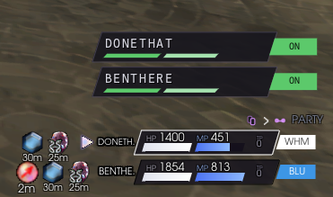 <em>Vex, Party, view B.</em>

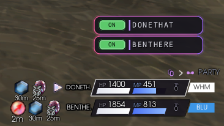 <em>Vex, Menu.</em>

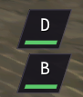 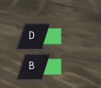 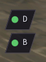 <em>Vex letter styles A (dark plate, white letter, state bar), B (letter plate and tag) and C (letter and dot).</em>

#### Hex link

- **View A**: the name, a gold divider, then the ON / OFF tag.
- **View B**: the ON / OFF tag (upright on the left, slanted on the right), then the name over a pointed HP-style bar, and an empty box at the right.
- **Name style**: the full name or one letter in style A, B or C, with the same view flip as Vex.
- **Gold corner accents** on or off, and **Corner cut** Small, Medium or Large.

 <em>Hex link, view A.</em>

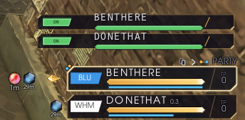 <em>Hex link, view B.</em>

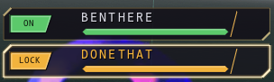 <em>Hex link, view B, with Donethat locked mid-cast.</em>

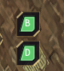 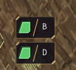 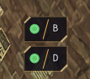 <em>Hex link letter styles A (letter in the tag), B (tag and letter) and C (dot and letter).</em>

#### Size, names and colours (Vex and Hex link)

- **Align** left or right, **Arrangement** Stacked or Inline, and **Rotation** 0 / 90 / 180 / 270.
- **Size**: Widget size, Overall length, Name box length and height, ON / OFF box length and height, and the Gap between name and ON / OFF (down to touching).
- Names are always in capitals and **shorten to fit** the name box ("BENTHE."). Drag the name box longer to see full names.
- **Background**: content and background opacity, background colour, and Name box opacity.
- **ON / OFF**: Show ON / OFF / LOCK text, the ON, OFF and LOCK colours, and Automatic tag text colour (dark text matched to each tag).

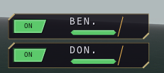 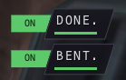 <em>Short name boxes: names shorten to fit.</em>

### What happens when you cast

| Step | What the addon does |
|---|---|
| 1 | You press a spell. If Wait until stopped is on and your character is still moving (running, auto-running or following), the cast request is held until you have stood still for the spell cast delay, then it is sent. It is never held longer than the max hold. |
| 2 | Follow is turned off: the Multisend "Cast starts" command is sent (default `/ms follow off`), and if In-game auto-follow is on, `/follow` is stopped. |
| 3 | If Release held keys is on, movement keys you are holding are released. |
| 4 | From the moment the game confirms the cast has begun until the server says it finished or was interrupted, the numpad movement keys (and W/A/S/D if on) are blocked, both as key presses and in the keyboard state the game reads each frame. The widget shows LOCK. |
| 5 | When the cast ends the keys unlock straight away. After the unlock wait (0 seconds after a finished cast, 10 seconds after an interrupted one, by default) the "Cast ends" command is sent (default `/ms follow on`) and auto-follow comes back. |
| 6 | If the cast was interrupted (hit, stunned, silenced, knocked back, paralyzed, intimidated, or the target died), the widget blinks a red INT for 2 seconds. For hits, knockback and silence the server only reports the failure when the cast time is up, so INT appears then. |
| 7 | `/stopmove move` (or General > End the cast lock now) ends the lock at any time, and follow comes back right away. |
| 8 | Safety net: the lock ends after Max cast lock (9 seconds by default) or the spell's own cast time plus 2 seconds, whichever is longer. It also clears when you zone, and if the server has not confirmed the cast within 3 seconds. |

| Setting (Timing page) | Default | Meaning |
|---|---|---|
| Spell cast delay (s) | 0.15 | How long you must stand still before a held cast is sent. 0.25 to 0.30 is safer if you cast while following. |
| Max hold (s) | 1.0 | Longest a cast is held; it is sent anyway after this. |
| Max cast lock (s) | 9.0 | Safety cap on the lock and the follow-off. Long spells automatically get their own cast time plus 2 seconds (Raise 17 s, Teleports 22 s). |
| Unlock wait: cast completed (s) | 0.0 | Delay before follow turns back on after a finished cast. |
| Unlock wait: cast interrupted (s) | 10.0 | Same, after an interrupted cast. |

### Follow while casting

**Multisend follow.** Turn it on and check the two commands: "Cast starts" (default `/ms follow off`) and "Cast ends" (default `/ms follow on`). A blank box sends nothing. With Hide Multisend follow messages on, Multisend's "Follow is currently ..." replies to these commands are kept out of the chat log; a `/ms follow` you type yourself still shows.

**In-game auto-follow (`/follow`).** Turn on Stop and resume /follow, and StopMove stops the game's own follow when a cast starts and starts it again afterwards.

- **Follow after cast** box: type a character name (for example Benthere) and, after every cast, auto-follow is turned on and pointed at that character, even if you were not following anyone before. Capitals do not matter.
- The character must be in the same zone; if not, nothing is sent.
- Both clients share this setting. The character whose name is typed never tries to follow itself, so you can type the leader's name once and only the other character follows.
- Leave the box blank to re-follow whoever you were following when the cast started.

### The settings window

Open it with `/stopmove` or a right-click on the widget. Every change is saved automatically. Pick a page in the sidebar, or type in **Search** to see every matching setting at once. The small circular-arrow icon next to a section title resets just that section.

| Page | What is in it |
|---|---|
| About | What StopMove does, its commands, how to use the widget, and credits. |
| General | Enabled for this character; Show the widget; Lock widget position and size; End the cast lock now. |
| Casting | Disable numpad 8 / 2 / 4 / 6; Also disable W / A / S / D; Release held keys at cast start; Wait until stopped before casting. |
| Follow | Multisend follow with its "Cast starts" and "Cast ends" commands and Hide Multisend follow messages; Stop and resume /follow with the Follow after cast name box. |
| Timing | Spell cast delay and Max hold; Max cast lock and the two unlock waits. |
| Widget > Appearance | Theme, Reset and Copy; Arrangement, Rotation and Align; Size; the Vex or Hex link options; Background; Names; ON / OFF. |
| Tools | **Save and load**, **Test lock** (shows LOCK on your widget for 3 seconds) and **Reset all**. |

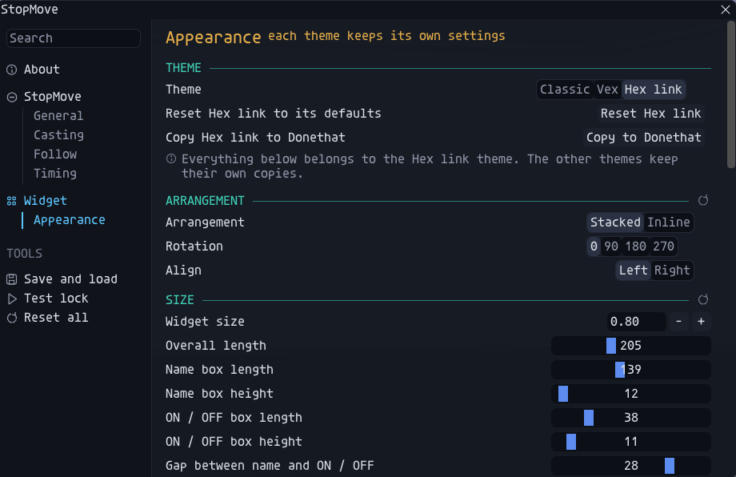 <em>The settings window: the Appearance page with the Hex link theme selected.</em>

### Save, load and push

The **Save and load** page (Tools in the sidebar) keeps whole setups: this character's themes and looks, plus the shared casting, follow and timing settings.

- **Save**: type a file name and click Save. The character's name is added to the front, so "my setup" saved on Benthere becomes "Benthere - my setup".
- **Load**: pick a setup from the dropdown and click Load. It changes this character's looks and the shared settings (on both clients).
- **Push to <other character>**: sends the selected setup to the other client. **Push now** sends the settings in use right now. Pushing takes two clicks: the first turns the button red ("Click again to push"), and a second click within 4 seconds sends it. The other client first saves what it had (as "before push" with the date and time), then loads what you pushed.
- Setups are plain text files in the `saved` folder next to the addon: `<Ashita folder>\addons\stopmove\saved\`. You can copy them to share a setup.

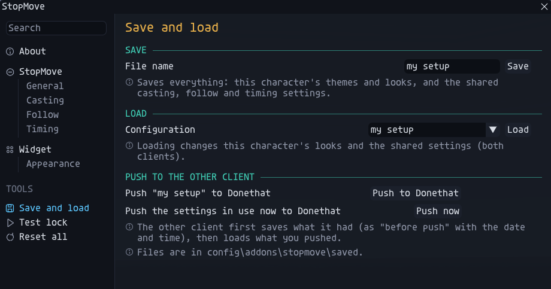 <em>The Save and load page.</em>

**Reset all** puts every setting, every theme and every look back to how StopMove starts. It asks first.

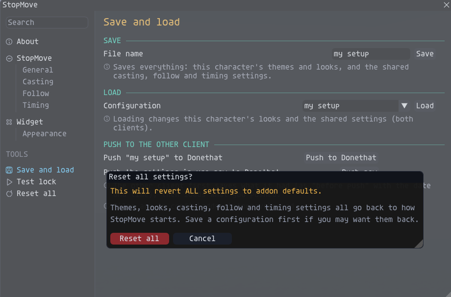 <em>The Reset all warning.</em>

### Using two clients

1. Load the addon on both clients (`/addon load stopmove`). They must use the same Ashita folder.
2. After a moment each widget shows both characters. Until then the second one says "(no 2nd client)".
3. Click a character, in either widget, to switch just that character on or off.
4. Each widget shows LOCK and INT for both characters.
5. Each character keeps its own widget position, size, theme and look. Casting, follow and timing settings are shared and update on both within about a second.
6. To give the other character your look, use **Copy <theme> to <name>** (Appearance) or **Push** (Save and load).
7. Key blocking and follow commands only ever act on the client that is casting.

### Commands

| Command | What it does |
|---|---|
| `/stopmove` | Opens or closes the settings window. |
| `/stopmove on`  /  `/stopmove off` | Turns StopMove on or off for the character you type it on. |
| `/stopmove move` | Allow Move: ends the cast lock now, on either character. |
| `/stopmove resetbox` | Puts the widget back at normal size in the top-left corner. |
| `/addon load\|unload\|reload stopmove` | Ashita's own commands to load, unload or reload the addon. |

### Where your settings are saved

Everything is plain text in `<Ashita folder>\config\addons\stopmove\`:

- `settings.txt`: the shared casting, follow and timing settings (shared by both clients).
- `look_<name>.txt`: that character's theme and look, for all three themes.
- `char_<name>.txt`: that character's widget position, size and ON/OFF state.
- `client_<name>.txt`, `cmd_<name>.txt`, `copy_<name>.txt` and `push_<name>.txt`: small files the two clients use to see, switch and send to each other. They are safe to delete when the game is closed.

Setups saved on the Save and load page are kept next to the addon, in `<Ashita folder>\addons\stopmove\saved\`.

To start fresh, use Reset all, or unload the addon and delete the settings folder.

### Troubleshooting

| Problem | Try this |
|---|---|
| I can't see the widget | Type `/stopmove` and turn on Show the widget (General). If it is off-screen, type `/stopmove resetbox`. |
| I can't move the widget | Hold Shift and drag it, or open the settings window and drag. Check Lock widget position and size (General) is off. |
| Numpad keys are not blocked while casting | Check the character shows ON, Disable numpad 8 / 2 / 4 / 6 is on, and you are using the numpad keys. Gamepad and mouse movement are never blocked. |
| My spell is interrupted even though I do not move | Keep Wait until stopped and Release held keys on, and raise Spell cast delay to 0.25 or 0.30. If you move with W/A/S/D, turn on Also disable W / A / S / D. |
| I can't move during a cast | That is the lock working. Type `/stopmove move` or use General > End the cast lock now. |
| The widget showed INT | The server cancelled the spell (a hit, stun, silence, knockback, paralysis, intimidation, or the target died). Follow waits the interrupted unlock wait (10 seconds by default) before coming back. |
| I don't follow again after a cast | Type the leader's name in Follow after cast. The leader must be in the same zone. After an interrupted cast, follow waits 10 seconds by default. |
| Follow keeps going during casts | Turn on Multisend follow and/or Stop and resume /follow, and check the "Cast starts" command. Other follow addons are not controlled. |
| Changing the look on one client did not change the other | Looks are per character since 3.0. Use Copy <theme> to <name> on the Appearance page. |
| Names are cut short ("BENTHE.") | Make the Name box length (or Overall length) bigger on the Appearance page. |
| Second character says "(no 2nd client)" | Load the addon on both clients, with the same Ashita folder, and give it a few seconds after login. |
| My settings did not save | Look for `settings.txt` and `look_<name>.txt` in `<Ashita folder>\config\addons\stopmove\` and check that the folder is not read-only. |

## About

### Credits

- Written by Claude (Anthropic), directed and tested by Benthere407.
- The Vex and Hex link theme appearances are modelled on **YunaUI** by **Yunas**.
- The settings window is inspired by the **VanaCore** menus by **Vekien** and **Josh.Xero**.
- Thanks to **Toots** for support in adjusting the cast lock durations for longer spells.
- Built on the Ashita v4 addon API and the Dear ImGui interface that ships with Ashita (AshitaXI).
- Multisend by ThornyFFXI is supported by sending its documented `/ms follow` command. None of its code is included.
- No code from YunaUI or VanaCore is included; StopMove draws its own look.

### Safety

- One plain-text Lua file. No .exe or .dll. The zip is a normal zip, not self-extracting.
- SHA-256 of stopmove.zip: 987f70fc9d6693b825ab4eb218eea59e1581bcc8e6b4feba44ed4e6428730996
- No account details, tokens or logins are in the file. It does not use the network.
- It does not cast, target, heal or fight for you. It is keyboard-only: gamepad and mouse movement are not blocked.
- For transparency: with Wait until stopped on, it briefly holds your own cast request and re-sends it unchanged. It can send simulated key-release events at cast start, and a key-press after Allow Move, for movement keys you are physically holding. With In-game auto-follow on, it stops and restarts the game's auto-follow, or sends `/follow <name>`. It reads the spell's cast time from the game's own spell data. It does not change position packets. Each of these can be switched off in the settings window.

### Bugs and questions

Report bugs or ask questions on the GitHub Issues page: https://github.com/Benthere407/StopMove/issues

### Package details and version history

| Item | Details |
|---|---|
| File in the zip | stopmove/stopmove.lua (about 161 KB, 3,339 lines, plain text) |
| SHA-256 stopmove.zip | 987f70fc9d6693b825ab4eb218eea59e1581bcc8e6b4feba44ed4e6428730996 |
| SHA-256 stopmove.lua | 36bf5ef497317ae0aad8ea26d8c04d9789e256d0f398aa8d41cf46784d0f7311 |
| Changes in v3.0 | Classic, Vex and Hex link themes, each with its own settings and Reset; new VanaCore-style settings window with Search; Save and load, Push and Copy to the other client; looks per character; red INT on interrupted casts; paralyzed and intimidated casts count as interrupted; the safety timer covers each spell's own cast time and Max cast lock defaults to 9 s; Shift + drag; widget UI and Allow Move buttons removed. |
| Changes in v2.0 | In-game auto-follow option with a Follow after cast name box; "Release now" renamed Allow Move, added as `/stopmove move`, frees both clients and re-presses held movement keys; Letter inside the shape widget; mouse-wheel resizing and a Widget size slider; Hold position while casting removed, so position packets are never changed. |
| Changes in v1.9 | Option to hide Multisend's "Follow is currently ..." messages caused by StopMove's own commands. |
| Changes in v1.3 to v1.8 | Movement keys also cleared from the keyboard state the game reads each frame while casting (v1.8); Low profile widget; option to hide the ON/OFF/LOCK text in the badge; drop shadow for name and ON/OFF text; Classic FFXI window frame; name turns orange while locked; the lock clears by itself if the server never confirms the cast within 3 seconds. |
| Changes in v1.2 | Option to also disable W/A/S/D; menu background colours re-measured from the Magic menu; "cfg" is now "UI"; "Show on-screen box" is now "Turn On/Off Widget"; ON/OFF badge can be a circle. |
