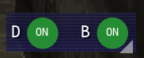
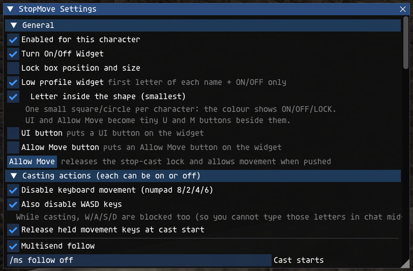
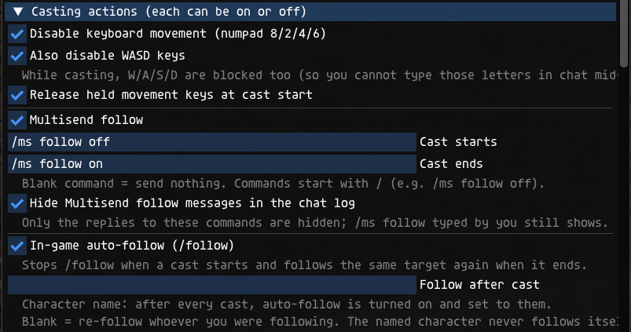
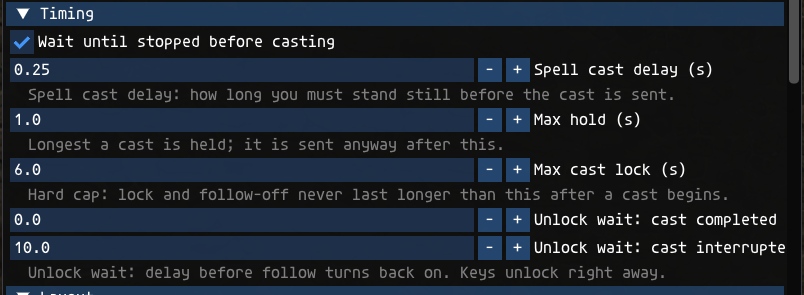
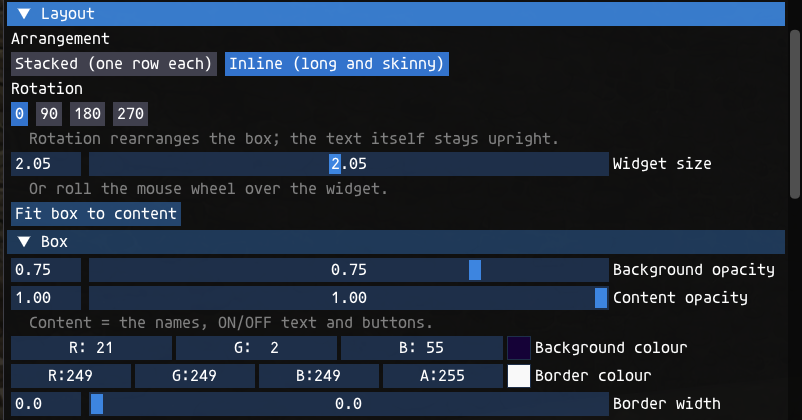
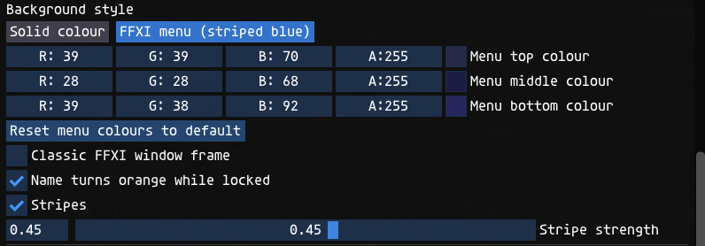
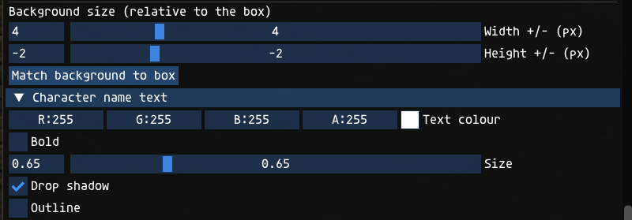
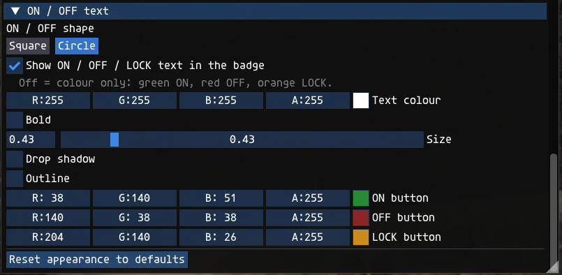

# StopMove user guide

_Version 2.0  |  Ashita v4 addon  |  user guide_

> **Download:** https://github.com/Benthere407/StopMove/releases/latest  
> **Project page:** https://github.com/Benthere407/StopMove  
> Tested on a current LandSandBoat (LSB) server running locally.

## Overview

### What it does

StopMove blocks your numpad movement keys (and, if you want, W/A/S/D) while you are casting, so you can't walk and interrupt a spell by accident. It can also turn Multisend follow and the game's own auto-follow (`/follow`) off for the length of the cast and back on afterwards, and it puts a small ON/OFF widget on screen, one badge per character, for people running two clients.

 <em>The widget, inline layout, square badges, FFXI menu style. Donethat is ON, Benthere is OFF.</em>

 <em>The same widget with circle badges.</em>

 <em>Low profile: first letter of each name plus its badge.</em>

 <em>Letter inside the shape: the smallest widget, one badge per character.</em>

### What's new in 2.0

- **In-game auto-follow.** `/follow` is stopped when a cast starts and resumed when it ends. You can also type a character name to follow after every cast.
- **Allow Move** (was "Release now"). It is now also a button on the widget and the command `/stopmove move`. It frees every locked character, and a movement key you are already holding moves you straight away.
- **Letter inside the shape.** The smallest widget: one small badge per character with the first letter inside. The UI and Allow Move buttons become tiny U and M badges.
- **Resize with the mouse wheel** over the widget, or with the new Widget size slider.
- **Hold position while casting has been removed.** StopMove no longer changes the position packets your client sends.

### Built with AI

StopMove was made with Claude (Anthropic's AI assistant). Benthere407 described what was wanted and tested each version in game; Claude wrote the code. The full source is in the zip as plain Lua, so anyone can read it.

### What it works with

| Item | Details |
|---|---|
| Client | Ashita v4 (Lua addon). Not for Windower. |
| Tested on | A current LandSandBoat (LSB) server running locally. |
| Renderer | The widget uses Ashita's built-in ImGui, so it should work with whatever renderer Ashita supports. |
| Optional | Multisend (by ThornyFFXI) for the Multisend follow option, used only through its `/ms follow` command. The in-game `/follow` option needs nothing extra. |
| Also used with | The author runs it next to LegacyAC. No conflicts known. |

## Install and uninstall

### How to install

1. Unzip `stopmove.zip`. You get a folder called `stopmove` containing `stopmove.lua`.
2. Copy the whole `stopmove` folder into your Ashita addons folder, so that this file exists: `<Ashita folder>\addons\stopmove\stopmove.lua`
3. In game, type `/addon load stopmove`. The widget appears at the left of the screen.
4. To load it automatically, add the line `/addon load stopmove` to your Ashita startup script (usually `<Ashita folder>\scripts\default.txt`, or whichever script your profile runs).
5. Running two clients? Do this once; both clients share the same Ashita folder. Load it on each client.

### Updating from an older version

Replace `stopmove.lua` with the new one and type `/addon reload stopmove` on each client. Your settings are kept.

### How to uninstall

1. In game: `/addon unload stopmove`.
2. Delete the line `/addon load stopmove` from your startup script, if you added it.
3. Delete the folder `<Ashita folder>\addons\stopmove`.
4. Optional: delete the settings folder `<Ashita folder>\config\addons\stopmove` (saved look, position and ON/OFF state).

## How to use StopMove

### The widget

Each character gets an ON/OFF badge. Green means ON, red means OFF, and orange "LOCK" shows while a cast is protecting you.

- Click a badge to switch that character on or off. With two clients running, either widget can switch either character.
- Drag the widget by its background to move it.
- To resize it, drag the small triangle in the bottom-right corner, roll the mouse wheel over the widget, or use Settings > Layout > Widget size. In Letter inside the shape mode there is no triangle, so nothing covers the tiny badges.
- The UI button (U in letter mode) opens the settings window. A right-click on the widget, or `/stopmove`, does the same.
- The Allow Move button (M in letter mode) ends the cast lock at once. It turns orange while either character is locked.
- If the widget ends up off-screen or huge, type `/stopmove resetbox`.
- Its position, size and ON/OFF state are remembered per character.

### Widget styles

| Style | How to get it |
|---|---|
| Normal | Full names next to ON/OFF/LOCK badges. Choose Stacked (one row each) or Inline (long and skinny) in Layout. |
| Low profile | Tick Low profile widget (General). Only the first letter of each name, plus the badge. |
| Letter inside the shape | Tick Low profile widget, then Letter inside the shape (smallest). One small square or circle per character with the letter inside; the colour shows ON/OFF/LOCK. Resize it with the mouse wheel. |

### What happens when you cast

| Step | What the addon does |
|---|---|
| 1 | You press a spell. If Wait until stopped is on and your character is still moving (running, auto-running or following), the cast request is held until you have stood still for the spell cast delay, then it is sent. It is never held longer than the max hold. |
| 2 | Follow is turned off: the Multisend "Cast starts" command is sent (default `/ms follow off`), and if In-game auto-follow is ticked, `/follow` is stopped. |
| 3 | If Release held movement keys is on, movement keys you are holding are released. |
| 4 | From the moment the game confirms the cast has begun until it finishes or is interrupted, the numpad movement keys (and W/A/S/D if ticked) are blocked, both as key presses and in the keyboard state the game reads each frame. |
| 5 | When the cast ends the keys unlock straight away. After the unlock wait (0 seconds after a finished cast, 10 seconds after an interrupted one, by default) the "Cast ends" command is sent (default `/ms follow on`) and auto-follow comes back. |
| 6 | Allow Move ends the lock at any time, and follow comes back right away. |
| 7 | Safety net: nothing stays locked longer than max cast lock (6 seconds by default), the lock clears when you zone, and it also clears if the server has not confirmed the cast within 3 seconds. |

| Setting (Timing section) | Default | Meaning |
|---|---|---|
| Spell cast delay (s) | 0.15 | How long you must stand still before a held cast is sent. 0.25 to 0.30 is safer if you cast while following. |
| Max hold (s) | 1.0 | Longest a cast is held; it is sent anyway after this. |
| Max cast lock (s) | 6.0 | Hard cap on the lock and the follow-off. |
| Unlock wait: cast completed (s) | 0.0 | Delay before follow turns back on after a finished cast. |
| Unlock wait: cast interrupted (s) | 10.0 | Same, after an interrupted cast. |

### Follow while casting

**Multisend follow.** Tick it and check the two commands: "Cast starts" (default `/ms follow off`) and "Cast ends" (default `/ms follow on`). A blank box sends nothing. With Hide Multisend follow messages ticked, Multisend's "Follow is currently ..." replies to these commands are kept out of the chat log; a `/ms follow` you type yourself still shows.

**In-game auto-follow (`/follow`).** Tick it and StopMove stops the game's own follow when a cast starts and starts it again afterwards.

- **Follow after cast** box: type a character name (for example Benthere) and, after every cast, auto-follow is turned on and pointed at that character, even if you were not following anyone before. Capitals do not matter.
- The character must be in the same zone; if not, nothing is sent.
- Both clients share this setting. The character whose name is typed never tries to follow itself, so you can type the leader's name once and only the other character follows.
- Leave the box blank to re-follow whoever you were following when the cast started.

### The settings window

Open it with `/stopmove`, the UI button, or a right-click on the widget. Every change is saved automatically. Sections, top to bottom:

| Section | What is in it |
|---|---|
| General | Enabled for this character; Turn On/Off Widget; Lock box position and size; Low profile widget, with Letter inside the shape (smallest); UI button and Allow Move button (show them on the widget); Allow Move (ends the cast lock now). |
| Casting actions | Disable keyboard movement (numpad 8/2/4/6); Also disable WASD keys; Release held movement keys at cast start; Multisend follow with "Cast starts" and "Cast ends" commands and Hide Multisend follow messages; In-game auto-follow (/follow) with the Follow after cast name box. |
| Timing | Wait until stopped before casting and the five timers shown above. |
| Layout | Stacked or Inline; rotation 0 / 90 / 180 / 270 degrees; Widget size; Fit box to content. |
| Box | Background and content opacity; background and border colour; border width; Background style: solid colour or FFXI menu (striped blue) with its colours, Classic FFXI window frame, Name turns orange while locked, Stripes and stripe strength; background width and height adjustments. |
| Character name text | Colour, bold, size, drop shadow, and an optional outline (colour and width). |
| ON / OFF text | Shape: Square or Circle; Show ON / OFF / LOCK text in the badge (untick for colour only); text colour, bold, size, drop shadow, optional outline; colours of the ON, OFF and LOCK badges. |

 <em>Settings window: General and the start of Casting actions.</em>

 <em>Casting actions: Multisend follow and In-game auto-follow with the Follow after cast box.</em>

 <em>Timing.</em>

 <em>Layout (with Widget size) and the top of Box.</em>

 <em>Box: background style and FFXI menu colours.</em>

 <em>Box: background size, then Character name text.</em>

 <em>ON / OFF text: shape, text options and badge colours.</em>

### Looks: layout, rotation, shape and background

**FFXI menu style.** Choosing "FFXI menu (striped blue)" resets the menu colours to the defaults every time you click it. The defaults were measured from the in-game Magic menu: grey-purple at the top, darker through the middle, bluer at the bottom, with dark 2-pixel stripes every 4 pixels. "Reset menu colours to default" puts them back.

**Background size.** The width and height sliders make the background bigger or smaller than the widget, anchored at its top-left corner. "Match background to box" sets both back to zero.

**Rotation** rearranges the widget, but the text stays upright. At 90 degrees the stacked layout becomes a wide strip with the names on top and the badges underneath; 180 reverses the order; 270 puts the badges on top.

### Using two clients

1. Load the addon on both clients (`/addon load stopmove`). They must use the same Ashita folder.
2. After a moment each widget shows both characters. Until then the second one says "(no 2nd client)".
3. Click a character's badge, in either widget, to switch just that character on or off.
4. Allow Move, on either widget, frees whichever character is locked.
5. Each character keeps its own widget position, size and ON/OFF state. Look, timing and follow settings are shared and update on both within about a second.
6. Key blocking and follow commands only ever act on the client that is casting.

### Commands

| Command | What it does |
|---|---|
| `/stopmove` | Opens or closes the settings window. |
| `/stopmove on`  /  `/stopmove off` | Turns StopMove on or off for the character you type it on. |
| `/stopmove move` | Allow Move: ends the cast lock now (same as the button). |
| `/stopmove resetbox` | Puts the widget back at normal size in the top-left corner. |
| `/addon load\|unload\|reload stopmove` | Ashita's own commands to load, unload or reload the addon. |

### Where your settings are saved

Everything is plain text in `<Ashita folder>\config\addons\stopmove\`:

- `settings.txt`: looks, timers, follow commands and the Follow after cast name (shared by both clients).
- `char_<name>.txt`: that character's widget position, size and ON/OFF state.
- `client_<name>.txt` and `cmd_<name>.txt`: tiny files the two clients use to see and switch each other. They are safe to delete when the game is closed.

To start fresh, unload the addon and delete that folder.

### Troubleshooting

| Problem | Try this |
|---|---|
| I can't see the widget | Type `/stopmove` and tick Turn On/Off Widget. If it is off-screen, type `/stopmove resetbox`. |
| Numpad keys are not blocked while casting | Check the character's badge says ON, Disable keyboard movement is ticked, and you are using the numpad keys. Gamepad and mouse movement are never blocked. |
| My spell is interrupted even though I do not move | Keep Wait until stopped and Release held movement keys on, and raise Spell cast delay to 0.25 or 0.30. If you move with W/A/S/D, tick Also disable WASD keys. |
| I can't move during a cast | That is the lock working. Click Allow Move (M in letter mode) or type `/stopmove move`. |
| I don't follow again after a cast | Type the leader's name in Follow after cast. The leader must be in the same zone. After an interrupted cast, follow waits 10 seconds by default (Unlock wait: cast interrupted). |
| Follow keeps going during casts | Tick Multisend follow and/or In-game auto-follow, and check the "Cast starts" command. Other follow addons are not controlled. |
| The widget is too small to click | Roll the mouse wheel over it to make it bigger, or set Widget size in Layout. |
| Second character says "(no 2nd client)" | Load the addon on both clients, with the same Ashita folder, and give it a few seconds after login. |
| My settings did not save | Look for `settings.txt` and `char_<name>.txt` in `<Ashita folder>\config\addons\stopmove\` and check that the folder is not read-only. |

## About

### Credits

- Written by Claude (Anthropic), directed and tested by Benthere407.
- Built on the Ashita v4 addon API and the Dear ImGui interface that ships with Ashita (AshitaXI).
- Multisend by ThornyFFXI is supported by sending its documented `/ms follow` command. None of its code is included.

### Safety

- One plain-text Lua file. No .exe or .dll. The zip is a normal zip, not self-extracting.
- SHA-256 of stopmove.zip: 18cbc58620cb1e352a5dbb916852b121ec1e2ac0f8acfcd2af4fc253c3f413f5
- No account details, tokens or logins are in the file. It does not use the network.
- It does not cast, target, heal or fight for you. It is keyboard-only: gamepad and mouse movement are not blocked.
- For transparency: with Wait until stopped on, it briefly holds your own cast request and re-sends it unchanged. It can send simulated key-release events at cast start, and a key-press after Allow Move, for movement keys you are physically holding. With In-game auto-follow on, it stops and restarts the game's auto-follow, or sends `/follow <name>`. It does not change position packets. Each of these can be switched off in the settings window.

### Bugs and questions

Report bugs or ask questions on the GitHub Issues page: https://github.com/Benthere407/StopMove/issues

### Package details and version history

| Item | Details |
|---|---|
| File in the zip | stopmove/stopmove.lua (about 78 KB, 1,799 lines, plain text) |
| SHA-256 stopmove.zip | 18cbc58620cb1e352a5dbb916852b121ec1e2ac0f8acfcd2af4fc253c3f413f5 |
| SHA-256 stopmove.lua | 041125923a658647bf272e14f853b3b0ee52c9e431be9ffea6c98704d13641d3 |
| Changes in v2.0 | In-game auto-follow option with a Follow after cast name box; "Release now" renamed Allow Move, added to the widget and as `/stopmove move`, frees both clients and re-presses held movement keys; Letter inside the shape widget with tiny U and M buttons; mouse-wheel resizing and a Widget size slider (no corner triangle in letter mode); Hold position while casting removed, so position packets are never changed. |
| Changes in v1.9 | Option to hide Multisend's "Follow is currently ..." messages caused by StopMove's own commands. |
| Changes in v1.3 to v1.8 | Movement keys also cleared from the keyboard state the game reads each frame while casting (v1.8); Low profile widget; option to hide the ON/OFF/LOCK text in the badge; drop shadow for name and ON/OFF text; Classic FFXI window frame; name turns orange while locked; the lock clears by itself if the server never confirms the cast within 3 seconds. |
| Changes in v1.2 | Option to also disable W/A/S/D; menu background colours re-measured from the Magic menu; "cfg" is now "UI"; "Show on-screen box" is now "Turn On/Off Widget"; ON/OFF badge can be a circle. |
